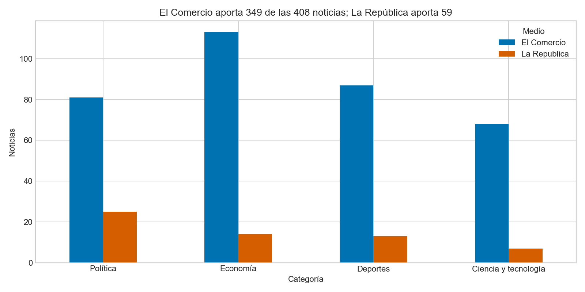
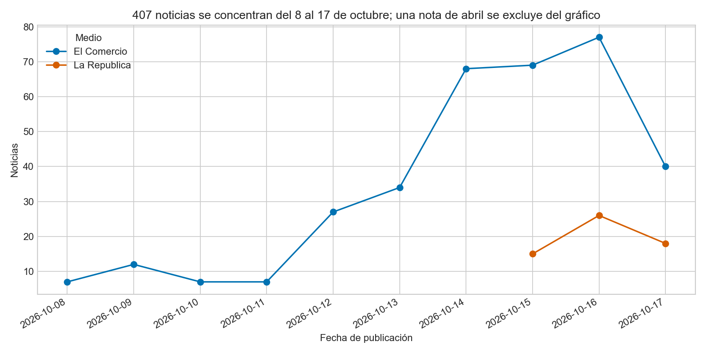
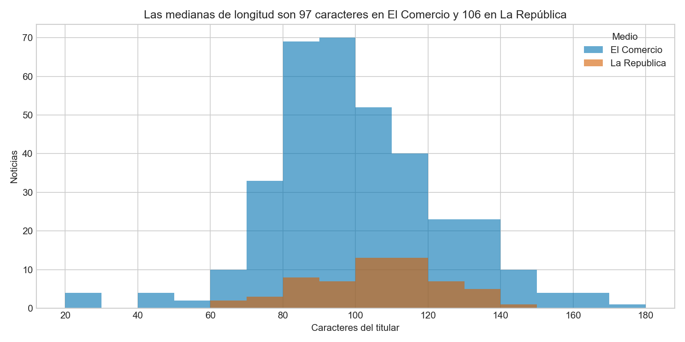

# Tarea 1 — Del titular al clasificador

**Alexander Noblejas (@AlexNoblejas)** · Python Intermedio, QLAB · Opción C — Comparada

## 1. Pregunta y metodología

¿Pueden convertir titulares peruanos en un clasificador de noticias?

Se recolectaron noticias, se generaron etiquetas con Qwen 2.5 7B mediante Ollama,
se documentó una auditoría humana de 20 casos y se ajustó DistilBERT multilingüe.
El dashboard permite explorar el corpus y clasificar titulares nuevos.
Categorías: `politica`, `economia`, `deportes`, `ciencia_tecnologia`.

## 2. Medios, fechas y evidencia de recolección

Descarga: **17 de octubre de 2026**. Corpus: **408 noticias**, 349 de El Comercio
y 59 de La República. Categorías: economía 127, política 106, deportes 100,
ciencia y tecnología 75. Hay 23 bajadas vacías, conservadas como texto vacío.
407 noticias están fechadas entre el 8 y el 17 de octubre; una conserva fecha de abril.

**La composición no cumple las 200 noticias por medio de la opción C.** Se documenta
esta desviación para que el docente pueda evaluarla; no se presume una excepción.

### Por qué se obtuvo 59 noticias de La República

El `robots.txt` respaldado prohíbe rutas de paginación `/pag/` y `/page/`, y permite
RSS y sitemaps. Se evitaron esas rutas prohibidas y se consultaron RSS y dos sitemaps
por cada una de las cuatro secciones: política, economía, deportes y ciencia.

Los ocho sitemaps guardados contienen **59 URLs únicas de artículos**, todas ya
presentes en el CSV (25 política, 14 economía, 13 deportes y 7 ciencia). Ninguno
aporta artículos adicionales. Es una limitación verificada de esos canales en esa
descarga; no prueba que cualquier otra estrategia permitida fuese imposible.

La revisión detectó que el lector histórico de los sitemaps normales tomaba
`image:loc` en lugar del `loc` del artículo. La lectura corregida del respaldo
recupera las mismas 59 noticias, sin añadir registros. Se conserva el código de la
corrida original y se aporta un verificador independiente con la corrección.

Evidencia verificable incluida en [datos/evidencia_recoleccion/](datos/evidencia_recoleccion/):
robots de ambos medios, los ocho XML respaldados y un resumen CSV con sus hashes.
`python verificar_evidencia.py` comprueba esta conclusión localmente, sin red ni entrenamiento.

Se utilizó un User-Agent académico, pausas de 1–2 segundos, máximo un reintento
y caché en `datos/raw/`. El respaldo completo permanece local; se versiona aquí
solo la evidencia pequeña necesaria. El notebook muestra el mapeo de secciones,
la limpieza y seis descartes por categorías no admitidas.

## 3. Dos hallazgos analíticos

**1. El clasificador supera al baseline en este test y bajo la misma referencia.**
Con titular + bajada y referencia LLM, DistilBERT obtiene F1 macro 0.891 y accuracy
0.903, frente a F1 0.511 del zero-shot sobre las mismas 62 noticias. La latencia
registrada fue 47.6 ms por noticia en CPU, frente a unos 449 ms del zero-shot.
Estas cifras dependen del equipo, la entrada y el corpus utilizados.

**2. Economía y tecnología presentan las fronteras menos claras.** Política
(F1 0.973) y deportes (0.970) superan a economía (0.839) y ciencia/tecnología
(0.783). La matriz muestra confusiones especialmente entre las dos últimas.
El F1 contra la sección del diario es 0.894; esto ofrece una comprobación adicional,
pero no demuestra generalización fuera de esta muestra.





Las vistas PNG facilitan la lectura; se conservan también los tres gráficos Plotly
interactivos y sus títulos analíticos en el notebook original.

## 4. Limitaciones y alcance de los resultados

**1. Cobertura limitada y desbalance entre medios.** La ventana es corta, predomina
El Comercio y no se cumple el volumen por medio de la opción C. Un test pequeño
de 62 noticias no establece rendimiento en otras fechas, medios o temas.

**2. Supervisión débil y protocolo de evaluación.** Las etiquetas LLM no son una
verdad de oro. El acuerdo humano documentado es 19/20; una de las 408 filas LLM
carece de etiqueta válida y se excluye, dejando 407 filas: 284 train, 61 val, 62 test.
La partición es estratificada con semilla 42. Cuatro noticias del test habían
aparecido en el baseline inicial y dos en la auditoría previa al split: no debe
afirmarse aislamiento absoluto. No se identificó uso del test para elegir el checkpoint.

**Entrada de la demo.** El entrenamiento y el F1 principal usan titular + bajada.
Con los mismos pesos y test, usando solo titulares, se verificó F1 **0.847** y
accuracy **0.855**. La app recibe solo titulares y explica esta diferencia.
La probabilidad mostrada no ha sido calibrada como garantía de acierto.

**Herramienta de entrenamiento.** Se usó un bucle de PyTorch, tres épocas, batch 16
y selección por F1 macro de validación. Funciona, pero se aparta de la solicitud de
usar HuggingFace Trainer. No se ha reentrenado para cambiar esa implementación.

## 5. Ejecución local

Los comandos se ejecutan **dentro de `tarea_1/`**, con Python 3.11.

```powershell
python -m venv .venv
.\.venv\Scripts\Activate.ps1
python -m pip install -r requirements.txt
python -m streamlit run app.py
```

En macOS/Linux, activar con `source .venv/bin/activate`.

**Para quien ya tiene los pesos locales:** no es necesario volver a ejecutar los
notebooks para abrir la app. Deben estar `modelo/config.json`, el tokenizer y
`modelo/model.safetensors` (541,323,528 bytes). Los pesos se excluyen de Git por tamaño.

**Para un clon nuevo:** los pesos no se descargan con GitHub. Hay que obtenerlos
por una vía de distribución facilitada por el autor, o ejecutar los notebooks para
generarlos. No se ofrece todavía un identificador público de Hugging Face.
La app permite usar `HF_MODEL_ID` cuando exista ese repositorio de modelo.

Para reproducir el proceso completo (opcional para abrir la app con pesos locales):

```powershell
ollama pull qwen2.5:7b
# Mantener Ollama en ejecución; ollama serve si no está iniciado.
python -m jupyterlab
# Abrir 01_recoleccion.ipynb y después 02_clasificacion.ipynb.
```

Cambiar las noticias requiere regenerar etiquetas, particiones y entrenamiento;
no reutilizar automáticamente pesos de un corpus anterior. Las versiones fijadas
corresponden al entorno existente; no se certifica aquí una instalación desde cero.

## Resultados y decisión

| Evaluación | Accuracy | F1 macro |
|---|---:|---:|
| Zero-shot, 40 casos iniciales, referencia sección | 0.700 | 0.682 |
| Zero-shot, test de 62, referencia LLM | — | 0.511 |
| DistilBERT, test de 62, titular + bajada, referencia LLM | 0.903 | 0.891 |
| DistilBERT, mismo test e entrada, referencia sección | 0.903 | 0.894 |
| DistilBERT, mismo test, solo titular, referencia LLM | 0.855 | 0.847 |

Acuerdo LLM–humano: **19/20 (95%)**. Se conserva el CSV de auditoría original.
El LLM alcanza F1 0.936 frente a la sección del diario en el test; su F1 contra sus
propias etiquetas es 1 por construcción y no mide calidad independiente.

Se elige DistilBERT para la demo por su equilibrio de rendimiento y latencia.
Antes de producción harían falta más fechas y medios, un test humano independiente
y evaluación de calibración. El despliegue en nube es opcional y no se ha realizado.

Los resultados históricos y pesos se conservan. La revisión del 18 de octubre
añade evidencia, documentación, vistas estáticas y la evaluación ya comprobada de
solo titulares; no cambia las noticias, la auditoría, las particiones ni el modelo.
