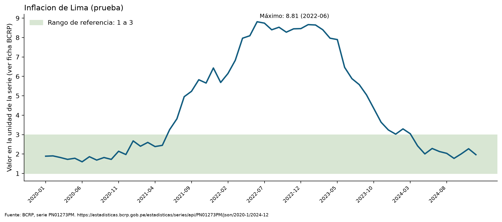
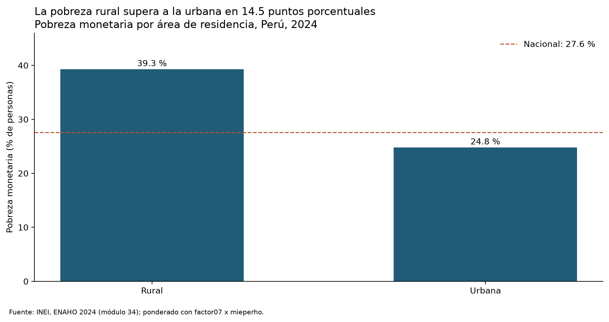
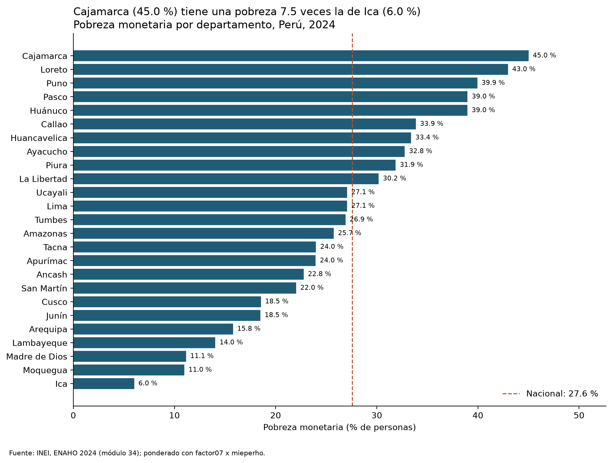
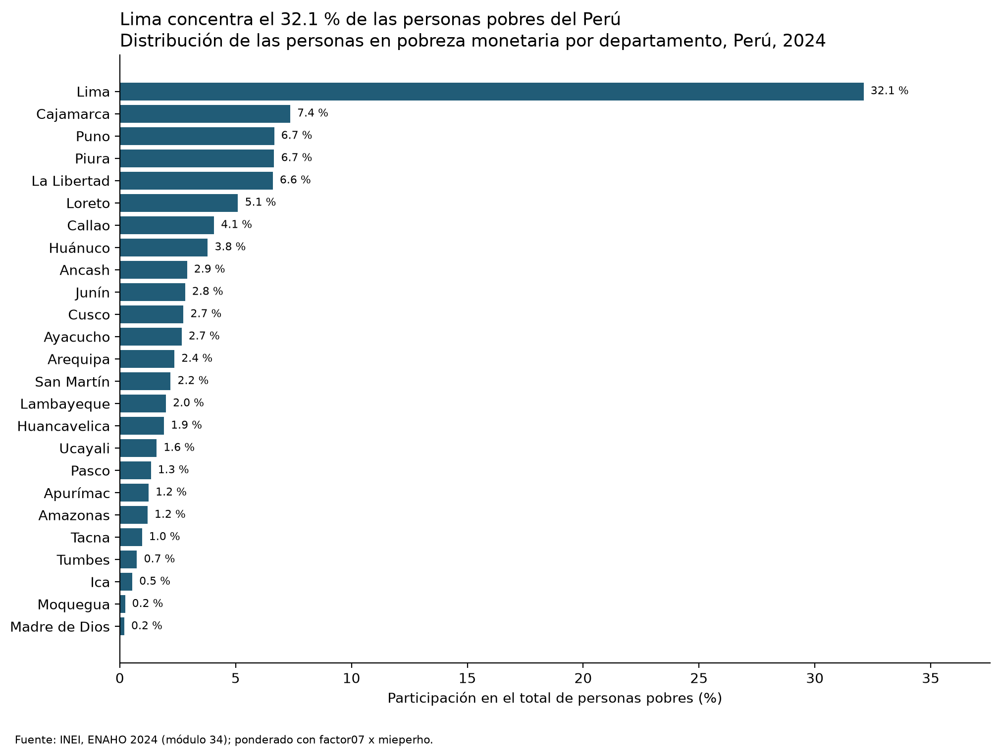
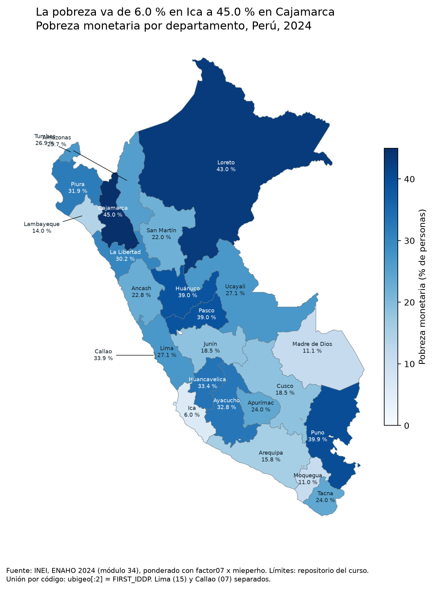

# Inflación de Lima fuera de la meta (2020–2024) y pobreza monetaria 2024 por área y departamento

## 1. Pregunta de investigación

**Tema.** Inflación de Lima Metropolitana frente al rango meta del BCRP y geografía de la pobreza monetaria en el Perú.

**Objetivo.** (a) Medir cuántos meses de 2020-01 a 2024-12 la inflación a 12 meses estuvo fuera del rango meta de 1 % a 3 %. (b) Mostrar, para 2024, dónde es más alta la tasa de pobreza monetaria y dónde vive la mayor parte de las personas pobres, por área y por departamento.

**Delimitación.** Inflación: serie mensual de Lima Metropolitana, 60 observaciones. Pobreza: corte anual ENAHO 2024, nacional, 2 áreas y 25 departamentos (Lima y Callao separados). Las dos partes se presentan como contexto; no se afirma que una explique a la otra.

El rango meta de 1 % a 3 % es un dato de política del BCRP: https://www.bcrp.gob.pe/politica-monetaria/

## 2. Fuentes y metodología

**BCRP (servidor MCP `bcrp`).** Serie `PN01273PM`, «Índice de precios Lima Metropolitana (var% 12 meses) - IPC», mensual, periodo 2020-01 a 2024-12, unidad: variación porcentual a 12 meses. URL: https://estadisticas.bcrp.gob.pe/estadisticas/series/api/PN01273PM/json/2020-1/2024-12. Se identificó con `buscar_series`. Los estadísticos salen de `resumen` y los periodos fuera de rango de `episodios_fuera_de_rango` (mínimo 1, máximo 3; un valor igual al límite cuenta como dentro).

**ENAHO 2024 (INEI), módulos 34 (sumaria) y 02 (miembros del hogar).** La Skill `limpiando-enaho` filtra residentes habituales (108 664 personas), une personas y hogares y calcula la pobreza monetaria. `salidas/validacion.txt` dice `RESULTADO: APROBADO`.

**Por qué cada tasa usa su factor de expansión.**
- Nacional, área y departamento: sumaria con `factor07 × mieperho`. El factor del hogar multiplicado por sus miembros da la población que representa el hogar. Así se reproduce la tasa oficial del INEI.
- Sexo y edad: residentes habituales con `facpob07`, el factor de persona, porque la unidad es la persona y no el hogar.
- Ambas versiones están en `salidas/indicadores.csv` (`pobreza_pct` y `pobreza_personas_pct`). Sin ponderar la tasa de hogares sería 20,22 % frente a 27,58 % ponderada (`salidas/validacion.txt`).

**Indicadores.** `pobreza_pct` (tasa), `personas_pobres` y `participacion_pobres_pct` (parte del total de personas pobres que vive en el grupo).

## 3. Resultados

**Hallazgo 1. La inflación estuvo fuera del rango meta 34 de 60 meses (56,7 %), todos por encima de 3 %.**
- 34 meses sobre el rango, 0 por debajo, 26 dentro.
- Un único episodio continuo: 2021-06 a 2024-03.
- Máximo 8,81 % en 2022-06; mínimo 1,60 % en 2020-06; promedio 4,47 %. En 2024-12 la inflación fue 1,97 %, dentro del rango.
- Unidad: % a 12 meses. Origen: `PN01273PM`, 2020-01 a 2024-12, URL de la sección 2 (herramientas `resumen` y `episodios_fuera_de_rango`).

**Hallazgo 2. La pobreza es más alta en el área rural y en Cajamarca, pero la mayoría de las personas pobres vive en áreas urbanas y en Lima.**
- Nacional 2024: 27,58 % (9 510 145 personas pobres). Rural 39,30 % frente a urbana 24,81 %.
- Las personas pobres urbanas son 6 918 052 (72,74 % del total) y las rurales 2 592 093 (27,26 %).
- Unidad: % de personas; factor `factor07 × mieperho`. Origen: `salidas/indicadores.csv`; figura `figuras/pobreza_area_2024.png`.

**Hallazgo 3. Por departamento, la tasa más alta es Cajamarca (45,01 %) y la más baja Ica (6,01 %).**
- Siguen Loreto (42,97 %) y Puno (39,94 %).
- Lima tiene una tasa de 27,07 %, cercana a la nacional.
- Unidad: % de personas; factor `factor07 × mieperho`. Origen: `salidas/indicadores.csv`; figura `figuras/pobreza_departamento_barras_2024.png`.

**Hallazgo 4. Lima concentra casi un tercio de las personas pobres (32,11 %; 3 053 352 personas).**
- Le siguen Cajamarca (7,36 %), Puno (6,66 %), Piura (6,66 %), La Libertad (6,61 %) y Loreto (5,10 %).
- Madre de Dios es el menor, con 0,19 %.
- Unidad: % del total nacional de personas pobres. Origen: `salidas/indicadores.csv` (`participacion_pobres_pct`); figura `figuras/concentracion_pobres_departamento_2024.png`.

**Hallazgo 5 (complementario). Por edad, los menores de 15 años tienen la tasa más alta.**
- 0–14 años: 37,52 %; 60 o más: 22,02 %.
- Por sexo: mujeres 27,68 % y hombres 27,37 %.
- Factor `facpob07`. Origen: `salidas/indicadores.csv`.

**Contraste con las referencias.**
- `salidas/validacion.txt`: nacional 27,5795 % (sumaria) frente a 27,6 % de referencia; urbana 24,807 % frente a 24,8 %; rural 39,303 % frente a 39,3 %; pobreza extrema 5,505 % frente a 5,5 %. Todos APROBADO.
- Departamentos frente a la Sesión 16: diferencia máxima 0,049 pp (Amazonas), según `mapas/pobreza_departamento_vs_referencia.csv`. No se ajustó ningún valor.
- Por personas con `facpob07`, la tasa nacional es 27,53 %, urbana 24,74 % y rural 39,44 %. Las tasas difieren de las de la sumaria en décimas por la unidad y el factor, y las dos están dentro de sus tolerancias de validación. No hay discrepancias sin explicar.

**Sobre los conteos absolutos.** Los totales de personas salen de sumar los factores de expansión de la ENAHO: 9,51 millones de personas pobres. El INEI publica 9 395 000 para 2024 (nota de Andina del 8 de mayo de 2025). La tasa coincide, pero el conteo difiere cerca de 1,2 %. Por eso conviene leer los conteos de este informe como aproximados y apoyarse en las tasas y las participaciones.

## 4. Visualizaciones

BCRP: inflación de Lima a 12 meses con banda meta de 1 % a 3 %.

ENAHO: pobreza por área.

ENAHO: pobreza por departamento.

ENAHO: concentración de personas pobres por departamento.

Mapa de pobreza por departamento (25 unidades, Lima y Callao separados).

## 5. Interpretación

- **Inflación.** Más de la mitad del periodo quedó fuera de la meta, en un único episodio de 34 meses sobre 3 % entre 2021-06 y 2024-03. Hacia el final de 2024 la serie volvió al rango (1,97 % en diciembre).
- **Tasa frente a número de personas.** Estas dos preguntas tienen respuestas distintas. La tasa es más alta donde la pobreza afecta a una mayor proporción de la población: la zona rural (39,30 %) y departamentos como Cajamarca (45,01 %), Loreto (42,97 %) y Puno (39,94 %). Pero el número de personas pobres depende además del tamaño de la población. Lima tiene una tasa de 27,07 %, muy inferior a la de Cajamarca, y aun así reúne 32,11 % de todas las personas pobres porque su población expandida es de 11,2 millones. Lo mismo ocurre con el área: la tasa es mayor en lo rural, pero 72,74 % de las personas pobres vive en áreas urbanas.
- **Edad.** La pobreza infantil (37,52 %) es notablemente mayor que la de personas de 60 años o más (22,02 %); por sexo la diferencia es pequeña.
- Para una política focalizada, la tasa indica dónde la incidencia es más intensa y la participación indica dónde está el mayor número de personas por atender.

## 6. Limitaciones

- **Cobertura temporal.** La inflación cubre 60 meses (2020-01 a 2024-12); la pobreza es un único corte anual (2024). No hay serie de pobreza para comparar con la inflación en el tiempo.
- **Inflación de Lima frente a pobreza nacional.** `PN01273PM` mide precios en Lima Metropolitana; la pobreza es nacional y por departamento. Son indicadores de ámbito y frecuencia distintos, así que se presentan como contexto y no se comparan directamente.
- **Error muestral.** Las tasas son estimaciones de una muestra (por ejemplo, 2 045 personas en Madre de Dios y 2 500 en Apurímac, según `n_muestra`). Este informe no calcula intervalos de confianza, por lo que diferencias pequeñas entre departamentos, como Pasco (38,97 %) y Huánuco (38,96 %), no son interpretables.
- **Causalidad.** Nada de lo anterior demuestra que la inflación explique la pobreza ni que el territorio la cause; son descripciones.
- Los departamentos se leen con la tasa de la sumaria. Los valores de referencia (27,6 %, Sesión 16) son controles y no se usaron para ajustar resultados.

## 7. Reproducibilidad

- **Datos crudos** (en `datos/`, no versionados): `uv run python scripts/descargar_datos.py` (`966-Modulo34.zip`, `966-Modulo02.zip`, `peru_departamental_simple.geojson`).
- **Scripts de las Skills:**
  - `uv run python .claude/skills/limpiando-enaho/scripts/limpiar.py`
  - `uv run python .claude/skills/graficando-enaho/scripts/graficar.py --tipo area|departamento|concentracion`
  - `uv run python .claude/skills/mapeando-enaho/scripts/mapear.py`
- **Salidas:** `salidas/validacion.txt`, `salidas/indicadores.csv`, `salidas/personas_2024.parquet`, `mapas/pobreza_departamento_vs_referencia.csv`.
- **Figuras y mapa:** `figuras/bcrp_PN01273PM_2020-01_2024-12.png`, `figuras/pobreza_area_2024.png`, `figuras/pobreza_departamento_barras_2024.png`, `figuras/concentracion_pobres_departamento_2024.png`, `mapas/pobreza_departamento.png`.
- **Serie BCRP:** `PN01273PM`, 2020-01 a 2024-12, consultada con `buscar_series`, `resumen`, `episodios_fuera_de_rango` y `graficar_serie`.

## 8. Verificación de resultados y manejo de errores

Seis afirmaciones se comprobaron fuera del agente, de ambas fuentes. El detalle está en [`auditoria/VERIFICACIONES_MANUALES.md`](../auditoria/VERIFICACIONES_MANUALES.md).

| Afirmación | Valor calculado | Referencia | Fuente de la verificación | Resultado |
|---|---:|---:|---|---|
| Máximo de inflación, 2022-06 | 8,81 % | 8,81 % | Tabla web del BCRP | Coincide |
| Meses sobre 3 %, 2020-2024 | 34 | 34 | Conteo en la tabla web del BCRP | Coincide |
| Pobreza nacional 2024 | 27,58 % | 27,6 % | Cifra del INEI citada por Andina | Coincide al redondear |
| Pobreza urbana y rural 2024 | 24,81 % y 39,30 % | 24,8 % y 39,3 % | Cifra del INEI citada por Andina | Coinciden al redondear |
| Cajamarca y Loreto 2024 | 45,01 % y 42,97 % | 45 % y 43 % | Andina y referencia de la Sesión 16 | Coinciden al redondear |
| Participación de Lima en las personas pobres | 32,11 % | 32,11 % | Segundo cálculo directo sobre el `.dta` | Coincide |

**Diferencia observada.** Por personas con `facpob07`, las tasas nacional, urbana y rural son 27,53 %, 24,74 % y 39,44 %. La diferencia se debe a la unidad de análisis y al factor, y se conserva sin ajustar.

**Errores encontrados y cómo se trataron.**
- Con pedidos seguidos, el BCRP responde una página HTML en lugar de datos. El servidor espera y reintenta; si sigue fallando, devuelve un error explícito y no una cifra.
- Un código inexistente devuelve un error que lo nombra (`XX999`), y un rango inválido se rechaza. Ambos casos tienen pruebas en `mcp/`.
- Si una validación de la ENAHO falla, `limpiar.py` se detiene sin guardar la base, y las Skills de gráficos y mapas no corren sin `RESULTADO: APROBADO`.

## 9. Origen de este documento

Las secciones 1 a 7 las escribió el agente en la ejecución registrada en `evidencias_ia/integracion/claude_integracion.jsonl`. El original está en `evidencias_ia/integracion/informe_final_original_del_agente.md`. En la revisión posterior se agregaron solo la nota sobre los conteos absolutos y las secciones 8 y 9; no se cambió ninguna cifra del agente.
